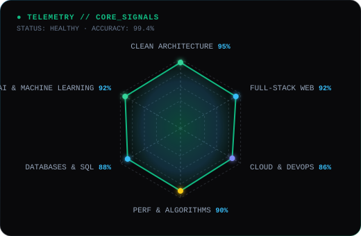

<div align="center">

<!-- ── CLI BANNER HEADER (ADAPTIVE DARK/LIGHT) ── -->
<a href="https://github.com/RomelGonza">
  <picture>
    <source media="(prefers-color-scheme: dark)" srcset="assets/banner-dark.svg">
    <source media="(prefers-color-scheme: light)" srcset="assets/banner-light.svg">
    
  </picture>
</a>

<br>

<!-- ── TERMINAL TYPING COMMAND PROMPT ── -->
<a href="https://github.com/RomelGonza">
  
</a>

<!-- ── QUICK CLI DOCK BADGES ── -->
<p align="center">
  <a href="mailto:Logonza64@gmail.com">
    
  </a>&nbsp;
  <a href="https://linkedin.com/in/romel-gonzalo">
    
  </a>&nbsp;
  <a href="https://github.com/RomelGonza">
    
  </a>&nbsp;
  
</p>

<!-- ── AMBIENT DIVIDER ── -->
<p align="center">
  
</p>

</div>

<!-- ── COMMAND 1: WHOAMI TERMINAL ── -->
## `$ whoami --verbose`

<p align="center">
  <picture>
    <source media="(prefers-color-scheme: dark)" srcset="assets/whoami-terminal-dark.svg">
    <source media="(prefers-color-scheme: light)" srcset="assets/whoami-terminal-light.svg">
    
  </picture>
</p>

<br>

<div align="center">
  
</div>

<!-- ── COMMAND 2: CAT TECH-STACK.YAML ── -->
## `$ cat /etc/tech-stack.yaml`

<div align="center">

<table border="1" cellpadding="14" bgcolor="#0e1015">
  <thead>
    <tr>
      <th colspan="2" align="left"><code>romel@workstation:~$ cat /etc/tech-stack.yaml</code></th>
    </tr>
  </thead>
  <tbody>
    <tr>
      <td width="50%" valign="top">
        <code>├─ ✦ languages_core:</code><br><br>
        <br>
        <sub><code>TypeScript · Python · JavaScript · C++ · R · Bash</code></sub>
      </td>
      <td width="50%" valign="top">
        <code>├─ ☁ cloud_and_storage:</code><br><br>
        <br>
        <sub><code>Supabase · PostgreSQL · Docker · Linux · Git · Vercel</code></sub>
      </td>
    </tr>
    <tr>
      <td valign="top">
        <code>├─ ⚛ modern_web_apps:</code><br><br>
        <br>
        <sub><code>Next.js (App Router) · React · Tailwind CSS · Three.js · HTML5/CSS3</code></sub>
      </td>
      <td valign="top">
        <code>╰─ ⌁ intelligence_and_ai:</code><br><br>
        <br>
        <sub><code>PyTorch · TensorFlow · Scikit-learn · Pandas · NumPy · RAG Architectures</code></sub>
      </td>
    </tr>
  </tbody>
  <tfoot>
    <tr>
      <td colspan="2"><code>status: ready&nbsp;&nbsp;·&nbsp;&nbsp;runtime: node_v22 / python_3.12&nbsp;&nbsp;·&nbsp;&nbsp;env: production</code></td>
    </tr>
  </tfoot>
</table>

</div>

<br>

<div align="center">
  
</div>

<!-- ── COMMAND 3: TELEMETRY RADAR ── -->
## `$ kubectl get telemetry --namespace=competencies`

<p align="center">
  <picture>
    <source media="(prefers-color-scheme: dark)" srcset="assets/radar-dark.svg">
    <source media="(prefers-color-scheme: light)" srcset="assets/radar-light.svg">
    
  </picture>
</p>

<p align="center">
  <sub><code>signals: clean_architecture(95%) · full_stack(92%) · applied_ai(92%) · algorithms(90%) · status: optimal</code></sub>
</p>

<br>

<div align="center">
  
</div>

<!-- ── COMMAND 4: GIT STATUS TELEMETRY ── -->
## `$ git status --telemetry --summary`

<div align="center">

<picture>
  <source media="(prefers-color-scheme: dark)" srcset="https://github-readme-stats.vercel.app/api?username=RomelGonza&show_icons=true&theme=transparent&bg_color=09090b&title_color=38bdf8&text_color=a1a1aa&icon_color=10b981&border_color=272a30&hide_border=false">
  <source media="(prefers-color-scheme: light)" srcset="https://github-readme-stats.vercel.app/api?username=RomelGonza&show_icons=true&theme=transparent&bg_color=f8fafc&title_color=0284c7&text_color=475569&icon_color=059669&border_color=e2e8f0&hide_border=false">
  
</picture>
&nbsp;
<picture>
  <source media="(prefers-color-scheme: dark)" srcset="https://github-readme-stats.vercel.app/api/top-langs/?username=RomelGonza&layout=compact&bg_color=09090b&title_color=38bdf8&text_color=a1a1aa&border_color=272a30&hide_border=false">
  <source media="(prefers-color-scheme: light)" srcset="https://github-readme-stats.vercel.app/api/top-langs/?username=RomelGonza&layout=compact&bg_color=f8fafc&title_color=0284c7&text_color=475569&border_color=e2e8f0&hide_border=false">
  
</picture>

<br><br>

<picture>
  <source media="(prefers-color-scheme: dark)" srcset="https://github-readme-streak-stats.herokuapp.com/?user=RomelGonza&theme=dark&background=09090B&border=272A30&stroke=272A30&ring=10B981&fire=38BDF8&currStreakNum=FAFAFA&sideNums=FAFAFA&currStreakLabel=10B981&sideLabels=38BDF8">
  <source media="(prefers-color-scheme: light)" srcset="https://github-readme-streak-stats.herokuapp.com/?user=RomelGonza&theme=light&background=F8FAFC&border=E2E8F0&stroke=E2E8F0&ring=059669&fire=0284C7&currStreakNum=09090B&sideNums=09090B&currStreakLabel=059669&sideLabels=0284C7">
  
</picture>

</div>

<br>

<div align="center">
  
</div>

<!-- ── COMMAND 5: CONNECT ── -->
## `$ ./connect.sh --socials`

<div align="center">

<a href="mailto:Logonza64@gmail.com">
  
</a>&nbsp;&nbsp;
<a href="https://linkedin.com/in/romel-gonzalo">
  
</a>&nbsp;&nbsp;
<a href="https://github.com/RomelGonza">
  
</a>

<br><br>

```bash
# Clone contact payload & initiate handshake:
curl -s https://github.com/RomelGonza | grep "available"
```

<sub>Hecho con precisión técnica y arquitectura limpia · Romel Gonzalo Quispe Valero · Lima, Perú</sub>

</div>
