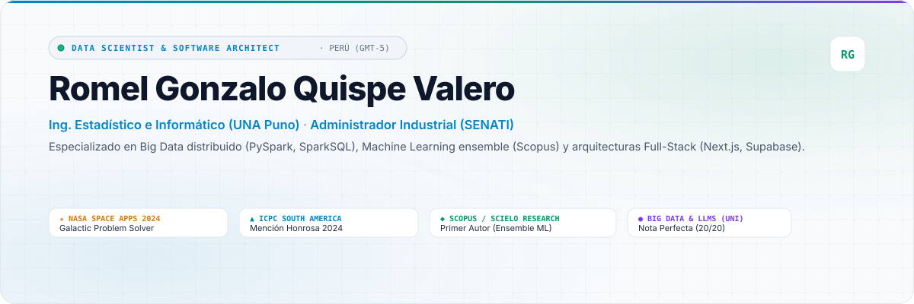
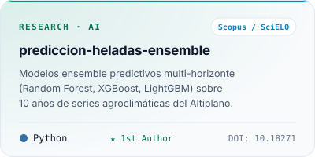
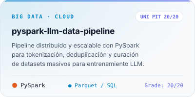
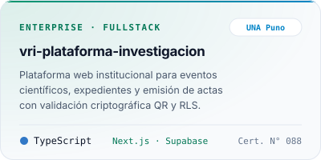
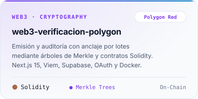
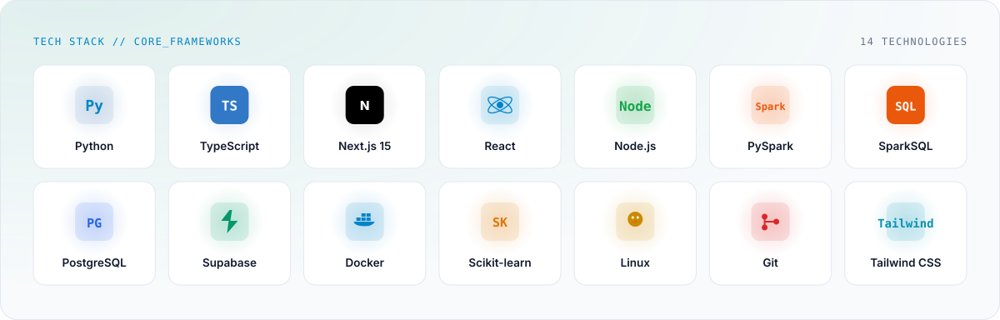
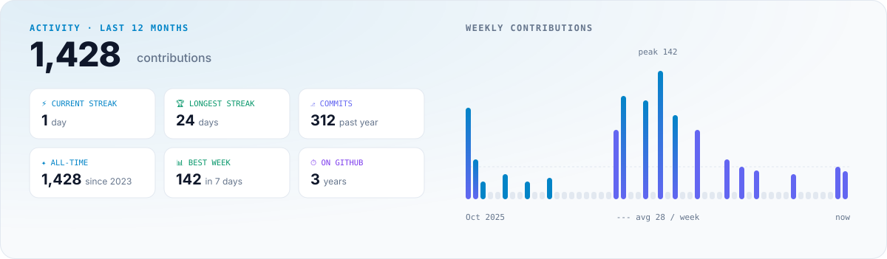
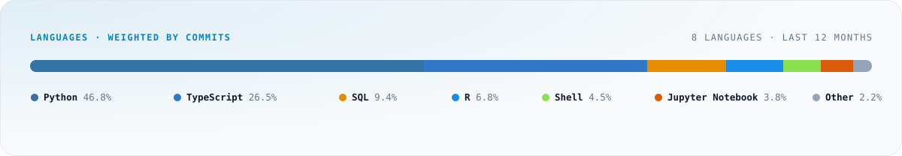

<!--
  Romel Gonzalo Quispe Valero · GitHub Profile
  Cards rendered in the Profilescape architecture (https://github.com/chethandvg)
  Telemetry, achievements and projects synced directly via Supabase
-->

<picture>
  <source media="(prefers-color-scheme: dark)" srcset="assets/hero-dark.svg" />
  
</picture>

<p align="center">
  <a href="https://github.com/RomelGonza">
    <picture>
      <source media="(prefers-color-scheme: dark)" srcset="assets/social-github-dark.svg" />
      
    </picture>
  </a>
  <a href="https://linkedin.com/in/gonza-qval">
    <picture>
      <source media="(prefers-color-scheme: dark)" srcset="assets/social-linkedin-dark.svg" />
      
    </picture>
  </a>
  <a href="mailto:Logonza64@gmail.com">
    <picture>
      <source media="(prefers-color-scheme: dark)" srcset="assets/social-email-dark.svg" />
      
    </picture>
  </a>
</p>

### About

Data Scientist y Software Architect especializado en **Big Data distribuido (PySpark, SparkSQL, Parquet)**, **Machine Learning** y **Arquitectura de Software Full-Stack (Next.js, TypeScript, PostgreSQL, Supabase, Docker)**.

Reconocido como **Galactic Problem Solver** en *NASA International Space Apps Challenge 2024* y **Mención Honrosa** en *ICPC South America Finals 2024*. Autor principal de investigación científica indexada en **Scopus / SciELO** sobre modelos ensemble predictivos aplicados a series temporales agroclimáticas.

<table>
  <tr>
    <td width="33%" valign="top">
      <b>Building</b><br/>
      <sub>Arquitecturas Full-Stack con Next.js 15, PostgreSQL y Supabase; plataformas institucionales con RLS y certificación criptográfica QR.</sub>
    </td>
    <td width="33%" valign="top">
      <b>Exploring</b><br/>
      <sub>Pipelines distribuidos de curación masiva para LLMs con PySpark (UNI 20/20), modelado multi-horizonte con Random Forest / XGBoost y batch anchoring en Polygon.</sub>
    </td>
    <td width="33%" valign="top">
      <b>Looking for</b><br/>
      <sub>Equipos ambiciosos y roles de alto impacto en Ciencia de Datos, Arquitectura de Software y Sistemas Distribuidos.</sub>
    </td>
  </tr>
</table>

### Featured work

<table>
  <tr>
    <td width="50%">
      <a href="https://doi.org/10.18271/ria.2026.849">
      <picture>
        <source media="(prefers-color-scheme: dark)" srcset="assets/repo-frost-prediction-dark.svg" />
        
      </picture>
      </a>
    </td>
    <td width="50%">
      <picture>
        <source media="(prefers-color-scheme: dark)" srcset="assets/repo-bigdata-llm-dark.svg" />
        
      </picture>
    </td>
  </tr>
  <tr>
    <td width="50%">
      <a href="https://eventosdii.vridevops.site/home">
      <picture>
        <source media="(prefers-color-scheme: dark)" srcset="assets/repo-vri-platform-dark.svg" />
        
      </picture>
      </a>
    </td>
    <td width="50%">
      <a href="https://cursos.vridevops.site/">
      <picture>
        <source media="(prefers-color-scheme: dark)" srcset="assets/repo-blockchain-web3-dark.svg" />
        
      </picture>
      </a>
    </td>
  </tr>
</table>

### Stack

<picture>
  <source media="(prefers-color-scheme: dark)" srcset="assets/stack-dark.svg" />
  
</picture>

### Activity

<picture>
  <source media="(prefers-color-scheme: dark)" srcset="assets/stats-dark.svg" />
  
</picture>

<picture>
  <source media="(prefers-color-scheme: dark)" srcset="assets/3d-dark.svg" />
  
</picture>

<picture>
  <source media="(prefers-color-scheme: dark)" srcset="assets/languages-dark.svg" />
  
</picture>

### Experience

```yaml
role: Data Scientist & Software Architect
highlights:
  - Vicerrectorado de Investigación (UNA Puno) | Sub Unidad de Plataformas de Investigación:
      - Plataforma institucional web en Next.js, TypeScript y PostgreSQL con Supabase (RLS y OAuth 2.0)
      - Subsistema de certificación digital con validación criptográfica QR (Certificado N° 088-2026-SG-UNA-PUNO)
      - Curación y análisis de series temporales agroclimáticas para investigación científica indexada
  - Empresa Agroindustrial NUTRILAC | Formación Dual SENATI:
      - Formulación de propuesta Lean Manufacturing y reducción de cuellos de botella operativos
      - Control Estadístico de Procesos (SPC), metodología 5S y seguimiento de KPIs de producción
credentials_and_awards:
  - NASA Space Apps Challenge 2024: Galactic Problem Solver (Earth Observation & Satellite Analytics)
  - ICPC South America Finals 2024: Mención Honrosa en Algoritmia y Programación Dinámica
  - Scopus / SciELO Research: Primer Autor Principal (Modelos Ensemble Predictivos · DOI: 10.18271/ria.2026.849)
  - Universidad Nacional de Ingeniería (UNI PIT): Pipeline Distribuido Big Data para LLMs (Calificación 20/20)
```

<p align="center"><sub>Cards built with <a href="https://github.com/chethandvg/profilescape">Profilescape</a> · Information synced from Supabase.</sub></p>
